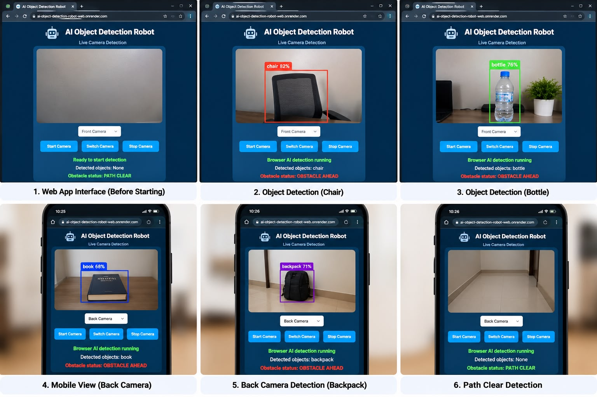

🤖 AI Object Detection Robot — Web Application

A mobile-friendly computer vision project that uses a live camera feed and browser-based AI to detect objects, display bounding boxes, and indicate potential obstacles.

🚀 Live Demo

Try the application: https://ai-object-detection-robot-web.onrender.com/

Open the website in a supported browser, allow camera access, and start detection.

✨ Features

* Real-time object detection through a camera
* Bounding boxes around detected objects
* Object labels and confidence scores
* Front and rear camera switching on supported devices
* Responsive interface for desktop and mobile browsers
* Potential obstacle status display
* Browser-based inference without sending camera frames to the Flask server

🛠️ Technologies Used

* Python — application backend
* Flask — web application server
* HTML, CSS, and JavaScript — user interface and camera access
* TensorFlow.js — browser-based machine learning
* COCO-SSD — object detection model
* GitHub — source code management
* Render — web hosting

⚙️ How It Works

1. The user opens the web application and grants camera permission.
2. JavaScript accesses the live camera feed.
3. TensorFlow.js and the COCO-SSD model process camera frames in the browser.
4. The application displays detected objects with bounding boxes and confidence scores.
5. A simple rule-based check displays whether a detected object is considered a potential obstacle.

💻 Run Locally

1. Install Python 3.
2. Clone this repository:

git clone https://github.com/Muhammedmiraz/AI-Object-Detection-Robot-Web.git
cd AI-Object-Detection-Robot-Web

3. Install the Python dependencies:

pip install -r requirements.txt

4. Run the browser-based application:

python app_phone_camera.py

5. Open the local address shown in the terminal.

Note: Camera access generally requires HTTPS or localhost. The application also requires an internet connection to load its browser-based AI libraries and model from the configured CDN.

🔒 Privacy and Safety

* In the browser-based version, camera frames are processed locally by the browser’s AI model.
* Camera access requires user permission.
* Obstacle detection is a demonstration and is not safety-certified for controlling a physical robot.

## 📸 Project Showcase

🎯 Project Objective

To explore computer vision, browser-based machine learning, camera integration, and mobile-friendly AI application development.

👨‍💻 Author

Muhammed Miraz P

GitHub: https://github.com/Muhammedmiraz

⸻

Developed as a software-based AI and computer vision portfolio project.
